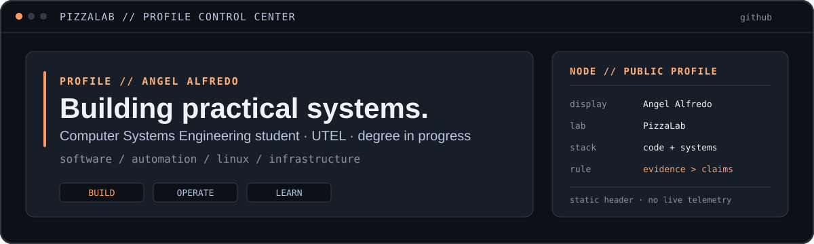

<p align="center">
  
</p>

<p align="center">
  <a href="https://alpizars2005-oss.github.io/aalfredo-dev/"><strong>Portfolio</strong></a>
  &nbsp;·&nbsp;
  <a href="https://github.com/alpizars2005-oss?tab=repositories"><strong>Repositories</strong></a>
  &nbsp;·&nbsp;
  <a href="https://github.com/alpizars2005-oss/job-search-mx-assistant"><strong>Current public project</strong></a>
</p>

---

## `PROFILE // ABOUT`

I'm **Angel Alfredo**, a Computer Systems Engineering student at **UTEL Universidad** — degree in progress.

I build practical software and automation, work with Linux and infrastructure in my homelab, and document projects with the same rule I use in PizzaLab: keep the architecture understandable, the boundaries explicit, and the claims tied to evidence.

My current direction sits between **software**, **systems / technical support**, and **infrastructure**. I also use coursework and labs to keep developing in QA, data, networking, and cybersecurity without presenting those learning areas as professional specializations.

> **Working style:** small dependencies, reproducible checks, privacy-aware design, useful rollback paths, and documentation that says what is actually implemented.

---

## `SYSTEMS // STACK`

| Layer | Tools I use |
| --- | --- |
| **Programming** | Python · JavaScript · HTML/CSS |
| **Automation & tooling** | Git · GitHub · GitHub Actions · shell / scripting |
| **Systems** | Linux · Proxmox · Docker · networking |
| **Data & local apps** | SQLite · JSON/CSV workflows · REST APIs |
| **Project-specific** | AutoHotkey v2 · Windows automation |

I keep this list intentionally small. A technology appears here because it is used in public projects, documented portfolio work, or the private PizzaLab infrastructure — not because I tried it once.

---

## `PROJECTS // SELECTED`

| Project | Boundary | What it represents |
| --- | --- | --- |
| **[Job Search Assistant](https://github.com/alpizars2005-oss/job-search-mx-assistant)** | **Public · owned** | Bilingual Python desktop/CLI workspace with SQLite, explainable fit analysis, opt-in public ATS discovery, local resume preparation, and tests for Windows/Linux. Candidacy submissions are simulated, not sent automatically. |
| **[Mochi Mochi](https://github.com/alpizars2005-oss/Mochi-Mochi)** | **Public · owned** | Dependency-light HTML/CSS/JavaScript application for menu, ordering, browser-local sales tracking, and CSV/Excel export. |
| **[Alpizers](https://github.com/alpizars2005-oss/Media-Manager-Releases)** | **Private source · public releases** | Windows media/download application. Development stays private; releases, integrity guidance, and distribution history are public. |
| **[Ultimate Macro](https://github.com/UltimateMacro/Ultimate-Macro-New-Era)** | **Community project · contributor** | Contributions to an existing open-source/community project, kept separate from project ownership. [Merged upstream PRs](https://github.com/UltimateMacro/Ultimate-Macro-New-Era/pulls?q=is%3Apr+author%3Aalpizars2005-oss+is%3Amerged) and a [public remote-control extension](https://github.com/alpizars2005-oss/ultimate-macro-remote) provide the evidence trail. |
| **[UCAMP Projects](https://github.com/alpizars2005-oss/Ucamp-Projects)** | **Public · coursework** | Learning history across Python fundamentals, validation, APIs, files, tests, Git/GitHub, visualization, and Scrum. |
| **[OpenPGP coursework](https://github.com/alpizars2005-oss/coursera-project1c-evidence)** | **Public · coursework** | File signing, public-key verification, and SHA-256 evidence using a historical Apache archive. Academic work, not an AWS deployment or a production-software recommendation. |

More context and project evidence live in my **[portfolio](https://alpizars2005-oss.github.io/aalfredo-dev/)**.

---

## `LAB // PIZZALAB`

**PizzaLab** is my private infrastructure homelab and the visual language behind this profile.

It is built around **Proxmox and Linux** and gives me a place to work hands-on with virtualization, containers, networking, storage, remote administration, service isolation, monitoring, and recovery-oriented thinking.

The implementation repository, infrastructure inventory, host details, and access paths stay private by design. Public descriptions focus on architecture and verified capabilities rather than exposing operational details or pretending this README is a live dashboard.

```text
PizzaLab
├─ virtualization      Proxmox
├─ systems             Linux
├─ services            containers + local applications
├─ network             private / remote-access aware
└─ principle           document what is real, keep sensitive details private
```

---

## `LEARNING // EDUCATION`

**Computer Systems Engineering — UTEL Universidad**  
*Degree in progress.*

Completed credentials and coursework:

- **[Google IT Automation with Python](https://www.credly.com/badges/5662042f-bdf4-49f3-ace8-5a40f70996b6)**: Professional Certificate completed in October 2026. The linked public badge was issued in November 2026.
- **Cisco Networking Academy**: [Endpoint Security](https://www.credly.com/badges/2c31d7cf-a971-4dbd-8bad-3a225edd953e) (November 2026), [Networking Devices and Initial Configuration](https://www.credly.com/badges/b485318d-6453-4bc6-9124-afbc16f5c1b9) and [Networking Basics](https://www.credly.com/badges/8c2bd554-dfd9-4965-ad30-05d0ba71692a) (October 2026), and [Introduction to Cybersecurity](https://www.credly.com/badges/529cd478-1e62-4931-b21f-fbd6d73a9971) (September 2026).
- **University of Colorado System / Coursera**: Basic Cryptography and Programming with Crypto API; Hacking and Patching; Design and Analyze Secure Networked Systems (October 2026); Secure Networked System with Firewall and IDS (November 2026). These are completed courses, not a claim of a completed specialization.
- **Google Cybersecurity**: Professional Certificate still in progress. Completed coursework includes Tools of the Trade: Linux and SQL and Assets, Threats, and Vulnerabilities (October 2026), plus Connect and Protect: Networks and Network Security (September 2026), alongside earlier foundations and security-risk courses.
- **EVOLVE DIGITAL, Utel-Cambridge Blended English Program**: B1+ course completed, 90 hours (October 2026).
- **[I validated and operated data - Outstanding](https://www.credly.com/badges/fe311b4d-fc9b-419d-a34f-d94a17ba67bd)**: Utel Universidad credential (September 2026).

Practice and public evidence:

- **[IT automation practice](https://github.com/alpizars2005-oss/it-cert-automation-practice)**: scripting, Git, service automation, and small lab artifacts.
- **[UCAMP Projects](https://github.com/alpizars2005-oss/Ucamp-Projects)**: Python, APIs, validation, files, testing, visualization, and Scrum.
- **[OpenPGP coursework](https://github.com/alpizars2005-oss/coursera-project1c-evidence)**: public signing and verification evidence, with the academic and deployment limits documented.

Coursework and projects support my learning in QA, data, networking, cybersecurity, and infrastructure. They are kept separate from professional work experience.

---

## `LINKS // CONTACT`

- **Portfolio:** [alpizars2005-oss.github.io/aalfredo-dev](https://alpizars2005-oss.github.io/aalfredo-dev/)
- **GitHub:** [@alpizars2005-oss](https://github.com/alpizars2005-oss)
- **Public work:** [repositories](https://github.com/alpizars2005-oss?tab=repositories)

For current CV and professional/contact links, use the portfolio above so this profile README does not duplicate or expose more personal information than necessary.

---

<p align="center">
  <sub><code>PizzaLab // build carefully · document clearly · evidence &gt; claims</code></sub>
</p>
